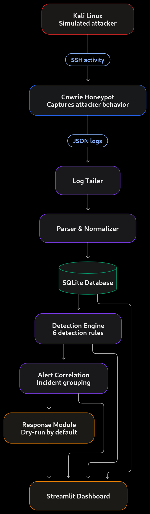
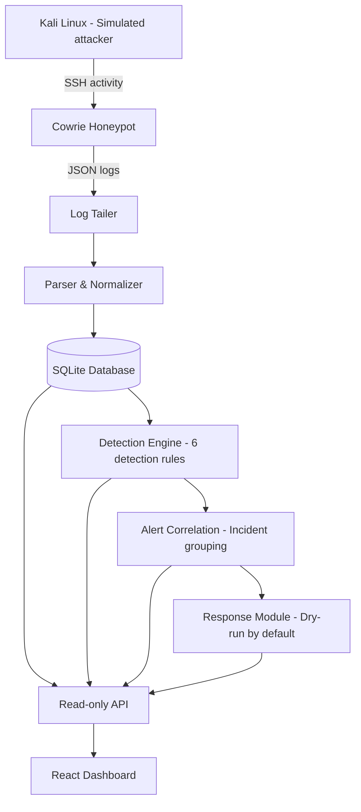

<div align="center">

# SENTRIX

### A lightweight honeypot-based intrusion detection and attack analysis platform

**Capture. Detect. Correlate. Respond.**

[](https://www.python.org/)
[](https://www.docker.com/)
[](https://www.sqlite.org/)
[](https://react.dev/)
[](https://www.starlette.io/)
[](#)

*A university cybersecurity project exploring how attacker activity can be collected, analyzed, turned into security alerts, and presented as incident timelines.*

</div>

---

## What is SENTRIX?

SENTRIX is a **small-scale security monitoring and attack-analysis prototype** built around a Cowrie SSH honeypot.

It creates an isolated Docker lab where simulated attacker activity is captured by Cowrie. SENTRIX processes the honeypot logs, detects suspicious behavior through a set of detection rules, groups related alerts into incidents, and displays the results in a React security operations dashboard backed by a read-only API. The original Streamlit dashboard remains in the repository as a legacy interface.

The goal is simple:

> Turn raw honeypot activity into understandable security events, alerts, and incident timelines.

## How it works
<div align="center">



<sub>SENTRIX — End-to-end architecture and workflow</sub>



</div>
### The workflow

1. **Generate activity** — Kali is used to simulate SSH attacks inside the lab.
2. **Capture** — Cowrie records connection attempts, login attempts, commands, and file-transfer activity.
3. **Ingest** — the tailer reads new Cowrie JSON log entries.
4. **Normalize** — the parser converts raw log records into a consistent event format.
5. **Store** — events and their related security data are stored in SQLite.
6. **Detect** — detection rules inspect events and identify suspicious patterns.
7. **Correlate** — related alerts are grouped by source IP and time into incidents.
8. **Respond** — the response module can record or attempt a containment action, depending on its configuration.
9. **Visualize** — the React dashboard reads events, alerts, incidents, and timelines through a strictly read-only API.

## Detection capabilities

SENTRIX currently includes six detection rules:

| Rule | Detection | What it looks for |
|:---:|---|---|
| R01 | Brute-force attempts | Repeated failed logins from one source IP |
| R02 | Password spraying | Failed logins against multiple usernames from one source IP |
| R03 | Successful login after failures | A successful login following repeated failures |
| R04 | Suspicious commands | Commands associated with discovery, credential access, downloads, persistence, reverse shells, or destructive activity |
| R05 | File-transfer activity | Upload/download events and relevant transfer commands |
| R06 | Connection flood / scan | A high number of connection attempts from one source IP in a short period |

These rules are designed for the behavior visible to the honeypot. They are not a replacement for endpoint detection, network-wide monitoring, or a production SIEM.

## Dashboard

The primary React dashboard lives in `frontend/` and provides:

- **Overview** — real event, alert, and incident totals, severity distribution, event activity, top sources and usernames.
- **Detection Alerts** — alerts generated by the detection engine, with filtering and linked evidence.
- **Incidents** — grouped alerts and incident-level information.
- **Incident Timeline** — every linked evidence record in original query order.

The frontend talks to the minimal read-only API in `api/`. The API reuses the existing `dashboard/queries.py` read layer, opens SQLite with `mode=ro`, never writes to the database, and never selects or returns password fields. The legacy Streamlit dashboard remains available through `make dash` but is no longer the primary interface.

```bash
# Terminal 1 — read-only API
make api

# Terminal 2 — React development server
make frontend
```

For a single-process deployment, build the frontend and let the API serve it:

```bash
make build-frontend
make api
# open http://localhost:8000
```

> **Screenshots:** Add your own screenshots to a folder such as `docs/images/`, then embed them below.  
> Example: ``

## Technology stack

| Technology | Role in the project |
|---|---|
| **Python** | Log processing, detection logic, correlation, and response |
| **Cowrie** | SSH honeypot and attacker-interaction logging |
| **Docker / Docker Compose** | Isolated lab services and repeatable environment |
| **SQLite** | Local persistence for events, alerts, incidents, and actions |
| **React + Vite** | Primary security operations dashboard (`frontend/`) |
| **Starlette + Uvicorn** | Minimal read-only HTTP API (`api/`) |
| **Streamlit** | Legacy dashboard, preserved for reference (`dashboard/`) |
| **Kali Linux** | Controlled attack simulation and testing |
| **iptables** | Optional host-level blocking action in response mode |

## Repository structure

```text
sentrix/
├── sentrix/                  # Core processing and security logic
│   ├── ingestion/            # Log tailing and parsing
│   ├── detection/             # Detection engine and rules
│   ├── correlation/           # Alert-to-incident correlation
│   ├── response/              # Response and containment logic
│   ├── main.py                # Main processing entry point
│   ├── config.py              # Configuration handling
│   ├── models.py              # Data models
│   ├── db.py                  # Database operations
│   └── schema.sql             # SQLite schema
├── api/                       # Minimal read-only HTTP API for the React dashboard
├── frontend/                  # React + Vite security operations dashboard
├── dashboard/                 # Legacy Streamlit dashboard and existing read-only queries
├── honeypot/                  # Cowrie configuration and log data
├── attacker/                  # Attack-scenario area
├── data/                      # Local database and demo data
├── tests/                     # Test area
├── docs/                      # Project documentation
├── docker-compose.yml         # Lab services
├── Dockerfile.kali            # Kali attacker container image
├── Makefile                   # Common project commands
└── requirements.txt            # Python dependencies
```

*The tree above highlights the main project areas; individual files and local runtime data may vary by branch or setup.*

## Getting started

### Requirements

- Linux host (recommended for the lab and optional firewall response)
- Docker Engine
- Docker Compose plugin
- Python 3
- Node.js 18+ and npm (React frontend)
- Git

### 1. Clone the repository

```bash
git clone https://github.com/chaouchmohamed/sentrix.git
cd sentrix
```

### 2. Review the configuration

Before starting the lab, review the Docker Compose file and the project configuration. Confirm the configured network, ports, log paths, and response settings match your environment.

### 3. Start the lab

Build and start the Docker Compose services:

```bash
docker compose up -d --build
```

Check the service status:

```bash
docker compose ps
```

### 4. Run the SENTRIX processor

Run the ingestion and detection pipeline using the command that matches your environment:

```bash
make replay   # replay the bundled Cowrie sample
# or
make run      # follow the live Cowrie log
```

Verify that the Cowrie log path used by the processor matches the path mounted by Docker Compose before using live mode.

### 5. Run the React dashboard

Install the API dependencies and the frontend packages once:

```bash
make api-install
make frontend-install
```

Then run the API and the Vite development server in separate terminals:

```bash
make api        # http://localhost:8000
make frontend   # http://localhost:5173
```

The Vite development server proxies `/api` to the read-only API. For a single-process deployment, run `make build-frontend` and then `make api`; the API will serve the built frontend at `http://localhost:8000`.

The legacy Streamlit dashboard is still available with `make dash`.

### 6. Stop the lab

```bash
docker compose down
```

To remove the lab containers and network, use `docker compose down`. Do not add `-v` unless you intentionally want to remove named volumes as well.

## Safety and responsible use

SENTRIX is intended for **authorized, isolated lab environments and educational demonstrations**.

- Do not expose the honeypot or attacker container to networks you do not control.
- Do not use the attack container against systems without explicit authorization.
- Keep response mode in **dry-run** while learning and testing.
- The optional firewall response can modify host firewall rules and may require elevated privileges. Understand the command and its impact before enabling it.
- Treat captured usernames, passwords, commands, and IP addresses as sensitive data. Do not publish real captured credentials or private logs.
- The React dashboard's API is read-only and does not expose plaintext password fields. Do not add write endpoints or password queries to the API without a deliberate security review.

## Project scope and limitations

SENTRIX is an educational prototype, not a production-ready SIEM or autonomous incident-response platform.

Current implementation considerations:

- Detection quality depends on the Cowrie events available and the configured thresholds.
- The response module's real firewall action can affect the host; dry-run should remain the default during development.
- Incident correlation is based on the implemented source-IP and time-window logic.
- Automated expiration/removal of a firewall block is not currently implemented.
- The repository's test and documentation areas are still being developed; validate behavior in your own lab before relying on it.

## Team

Developed as a **Computer Systems and Network Security (CSNS)** university project by:

- **Mohamed Abdellah CHAOUCH** — Project lead
- **Morsli Sid-Ahmed**
- **Arifi Yassine**

## Learning objectives

This project brings together practical cybersecurity concepts:

- Honeypots and attacker telemetry
- Log ingestion and event normalization
- Rule-based intrusion detection
- Alert correlation and incident timelines
- Docker-based lab isolation
- Database design and security dashboards
- Basic incident-response automation

## Contributing

Suggestions, bug reports, and improvements are welcome. If you want to contribute, open an issue describing the proposed change before submitting a pull request.

## License

No license has been specified yet. Unless a license is added to this repository, the default copyright rules apply and reuse is not automatically permitted.

---

<div align="center">

**SENTRIX — From raw attacker activity to actionable security insight.**

</div>
